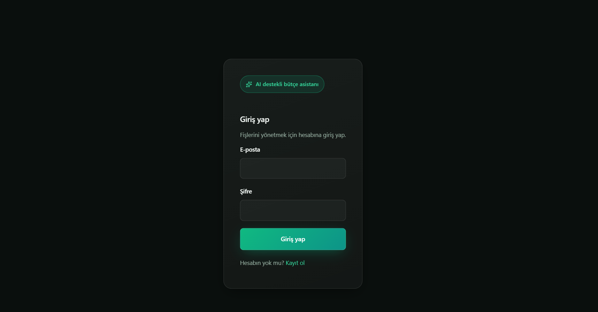
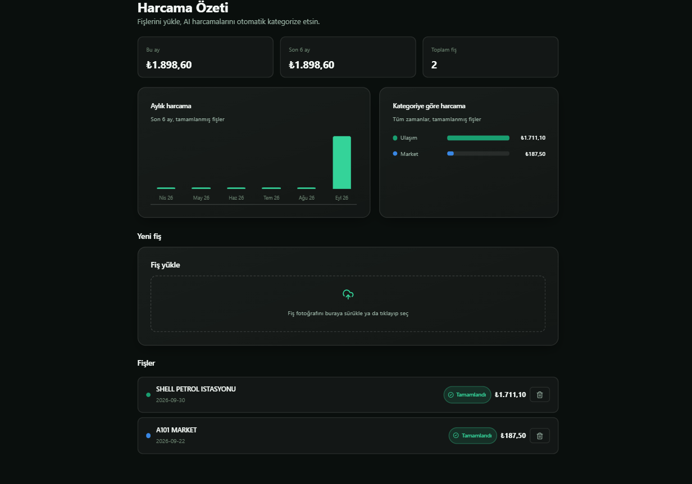
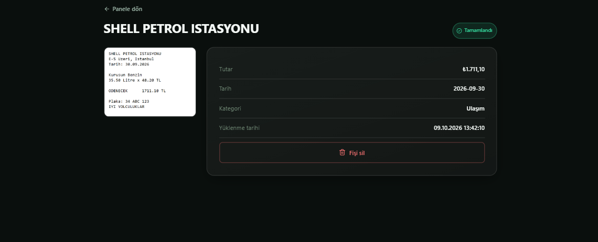

# AI Expense Tracker


Fiş/fatura fotoğrafı yükleyip Tesseract OCR + Gemini ile otomatik mağaza/tutar/tarih/kategori
çıkaran, aylık harcama ve kategori kırılımını grafikle gösteren kişisel bütçe asistanı.

## Mimari

- **backend/** — Ruby on Rails 8 API (PostgreSQL, Active Storage, Solid Queue, email/şifre + JWT auth)
- **frontend/** — React (Vite) SPA; giriş/kayıt, fiş yükleme, dashboard grafikleri, fiş detayı

Akış: Kullanıcı giriş yapar → fiş fotoğrafı yükler → arka planda `AnalyzeReceiptJob` çalışır:
**Tesseract** görselden ham metni çıkarır → ham metin **Gemini**'ye gönderilir → Gemini mağaza adı,
tutar, tarih ve kategoriyi JSON olarak döner → sonuç veritabanına kaydedilir. Frontend fiş durumunu
("Bekliyor" → "İşleniyor" → "Tamamlandı"/"Başarısız") birkaç saniyede bir otomatik kontrol eder;
başarısız analizler tek tıkla yeniden denenebilir.

İki adımlı OCR → LLM ayrıştırma mimarisi kasıtlı: Tesseract görseli metne çevirir, Gemini o metni
yapılandırılmış veriye dönüştürür — tek bir multimodal çağrıya göre daha fazla kontrol noktası ve
hata ayıklanabilirlik sağlar (OCR çıktısı `raw_text` kolonunda saklanır).

## Ekran Görüntüleri

| Giriş | Dashboard | Fiş Detayı |
|---|---|---|
|  |  |  |

## Örnek fişler

`sample-receipts/` klasöründe üç sentetik Türkçe fiş görseli var (market, restoran, akaryakıt) —
hızlıca denemek için doğrudan yükleyebilirsin.

## Gereksinimler

- Ruby 3.4+, Rails 8+, PostgreSQL (zaten kurulu)
- Node.js 20+
- [Tesseract OCR](https://github.com/UB-Mannheim/tesseract/wiki) (Windows'ta `winget install tesseract-ocr.tesseract`; `tur` ve `eng` dil paketleriyle gelir)
- Bir Gemini API key (ücretsiz, kredi kartı gerekmez: https://aistudio.google.com/apikey)

## 1. Ortam Değişkenleri

`backend/.env` dosyası zaten oluşturuldu (git'e girmez). İçini doldur:

```
GEMINI_API_KEY=<Gemini API key>
```

`JWT_SECRET` ve `FRONTEND_URL` otomatik dolduruldu. `TESSERACT_PATH` boş bırakılırsa Windows'ta
varsayılan kurulum yolu (`C:/Program Files/Tesseract-OCR/tesseract.exe`), diğer platformlarda
PATH'teki `tesseract` kullanılır.

## 2. Backend'i Çalıştırma

```bash
cd backend
bundle install          # ilk kurulumda zaten yapıldı
bin/rails db:create db:migrate db:prepare   # ilk kurulumda zaten yapıldı
bin/rails server -p 3000
```

PostgreSQL servis olarak kayıtlı değil (bu makinede admin yetkisi gerektiği için atlandı).
Her oturumda önce şunu çalıştırman gerekir:

```bash
"C:\Program Files\PostgreSQL\16\bin\pg_ctl.exe" -D "C:\Program Files\PostgreSQL\16\data" -l "C:\Program Files\PostgreSQL\16\data\logfile.log" start
```

Background job'lar (`AnalyzeReceiptJob`) development'ta Rails'in varsayılan `:async` adapter'ı ile
Puma sürecinin içinde çalışır — ayrı bir worker süreci gerekmez. (Production'da `solid_queue`
kullanılır; `plugin :solid_queue` Puma entegrasyonu Windows'ta `fork()` desteklenmediği için
development'ta kasıtlı olarak kapalı bırakıldı.)

## 3. Frontend'i Çalıştırma

```bash
cd frontend
npm install              # ilk kurulumda zaten yapıldı
npm run dev
```

Tarayıcıda http://localhost:5174 açılır.

## Teknoloji Özeti

| Katman | Teknoloji |
|---|---|
| Backend | Ruby on Rails 8 (API-only), PostgreSQL, Active Storage |
| Auth | Email/şifre (`has_secure_password`) + JWT (SPA için stateless auth) |
| OCR | Tesseract (`rtesseract` gem, yerel binary'ye shell-out) |
| AI | Google Gemini API (`gemini-2.5-flash`, ücretsiz katman) — OCR metnini yapılandırılmış JSON'a çevirir |
| Frontend | React 19 + Vite, React Router, Axios |
| Grafikler | Özel SVG/CSS bar grafikleri (dataviz skill'ine göre doğrulanmış, renk-körlüğü güvenli sabit kategori paleti) |

## Güvenlik Notu

`backend/.env` ve `backend/config/master.key` asla commit edilmez (`.gitignore`'da hariç
tutuldu). Şifreler `bcrypt` ile hash'lenir, her kullanıcı yalnızca kendi fişlerini görür/düzenler.
